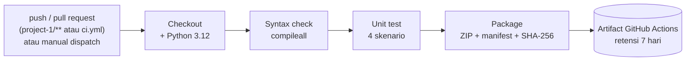
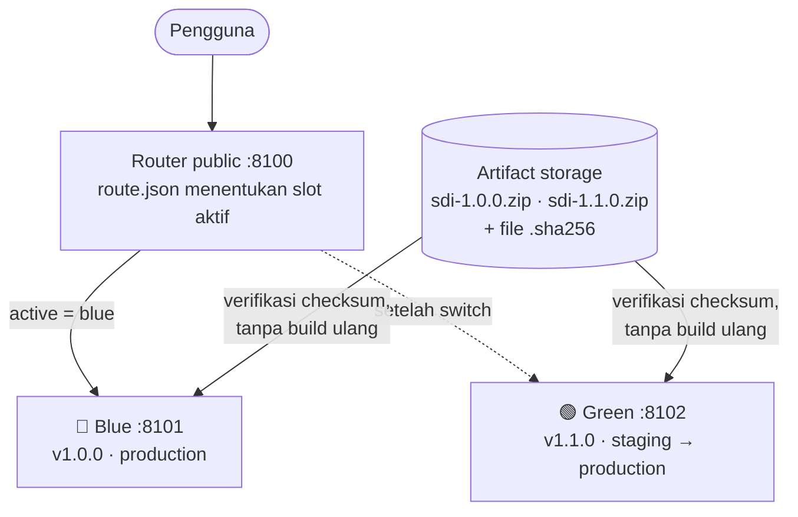
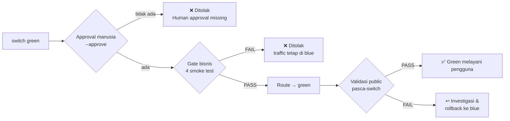

<div align="center">

# 🚀 Software Deployment and Implementation

### Kelompok 1 · Repository Praktikum, Tugas, dan Proyek Akhir

*Dari kode yang "jalan di laptop" menuju rilis yang dapat dibuktikan, dipromosikan, dan dipulihkan.*

[](https://github.com/djoov/kelompok1_SID/actions/workflows/ci.yml)


[Tentang](#-tentang-repository) •
[Tim](#-tim-pengembang) •
[Progress](#-progress-tracker) •
[Prinsip](#-prinsip-deployment-kami) •
[Sorotan Teknis](#-sorotan-teknis) •
[Memulai](#-memulai) •
[Kolaborasi](#-standar-kolaborasi)

</div>

---

## 📌 Tentang Repository

Repository resmi **Kelompok 1** untuk mata kuliah **Software Deployment and Implementation**. Seluruh tugas, praktikum, dan proyek akhir disimpan di sini lengkap dengan kode, pipeline, artifact, dan *evidence* dari setiap percobaan, sehingga setiap klaim dalam laporan dapat ditelusuri dan diuji ulang.

**Sorotan pekerjaan sejauh ini:**

- 🧪 **CI pipeline dengan artifact yang terlacak.** Setiap perubahan pada `project-1/` diuji otomatis, dipaketkan menjadi ZIP + manifest + checksum SHA-256, lalu disimpan sebagai artifact GitHub Actions.
- 🔵🟢 **Blue-green deployment dengan gate berlapis.** Kandidat bermasalah tetap ditolak walaupun sudah di-*approve*, dan gangguan setelah promosi dipulihkan lewat rollback traffic hingga 0/10 transaksi salah.
- 🧭 **Keputusan go-live berbasis bukti.** Analisis risiko, syarat minimum, dan kriteria NO-GO dari studi kasus *Monday Morning Go-Live*.

| Komponen | Keterangan |
| :--- | :--- |
| **Mata Kuliah** | Software Deployment and Implementation |
| **Program Studi** | S1 Teknik Informatika |
| **Semester** | 7 (Tujuh) |
| **Dosen Pengampu** | Agus Barlianto |
| **Institusi** | Perbanas Institute |
| **Kelompok** | Kelompok 1 |

---

## 👥 Tim Pengembang

<div align="center">

| | Nama | NIM | Peran | GitHub |
| :---: | :--- | :---: | :--- | :---: |
|  | **Nur Akhmad Van Jouvi** | `2314000024` | Koordinator · DevOps & Implementation | [@djoov](https://github.com/djoov) |
|  | **Judika Marpaung** | `2314000021` | Verification & Risk Analysis | [@JudikaM](https://github.com/JudikaM) |
|  | **Adelia Rahma Zalianty** | `2314000029` | System & Documentation | [@Adeliarzz](https://github.com/Adeliarzz) |

</div>

---

## 📊 Progress Tracker

| No | Milestone | Fokus Materi | Output | Status | Lokasi |
| :---: | :--- | :--- | :--- | :---: | :--- |
| 01 | **Task 01: Go-Live Readiness** | Deployment vs implementation, risiko go-live | Exit ticket individu + studi kasus kelompok *Monday Morning Go-Live* | ✅ Selesai | [`assignment/task-01`](./assignment/task-01) |
| 02 | **Praktikum CI Pipeline** | Continuous Integration & packaging artifact | Workflow GitHub Actions: syntax check → unit test → package → upload artifact | ✅ Selesai | [`project-1`](./project-1) · [`ci.yml`](./.github/workflows/ci.yml) |
| 03 | **Task 02: Blue-Green & Rollback** | Environment, release, dan recovery | Lab blue-green + laporan praktikum lengkap dengan evidence | ✅ Selesai | [`assignment/task-02`](./assignment/task-02) |
| 04 | **Task 03** | Menunggu materi pertemuan berikutnya | — | 📝 Direncanakan | [`assignment/task-03`](./assignment/task-03) |
| 05 | **Final Project** | End-to-end system deployment & monitoring | — | 📝 Direncanakan | [`final-project`](./final-project) |

> Keterangan status: `📝 Direncanakan` · `🚧 Dalam Pengerjaan` · `🔍 Siap Direview` · `✅ Selesai`

---

## 🧠 Prinsip Deployment Kami

Lima pelajaran yang kami buktikan sendiri lewat praktikum:

| # | Prinsip | Bukti di repository ini |
| :---: | :--- | :--- |
| 1 | **Build sekali, promosikan artifact yang sama.** | Checksum green sebelum dan sesudah promosi identik (`dfd15c9e…75f54`); yang berubah hanya konfigurasi. |
| 2 | **HTTP 200 bukan bukti layanan benar.** | Saat gangguan pasca-promosi, `/health` tetap 200, tetapi 3 dari 10 transaksi menghasilkan biaya salah. |
| 3 | **Approval manusia tidak bisa mengalahkan gate otomatis.** | `switch green --approve` tetap ditolak ketika gate bisnis green gagal. |
| 4 | **Rollback traffic bukan rollback data.** | Migration yang menghapus kolom akan memutus jalur kembali ke blue; solusinya pola *expand–contract*. |
| 5 | **Go-live adalah keputusan berbasis bukti.** | Kriteria NO-GO pada studi kasus: lebih baik menunda daripada merilis sistem yang belum siap. |

---

## 🔬 Sorotan Teknis

### 1. Praktikum CI Pipeline: [`project-1/`](./project-1)

Aplikasi kecil yang menjadi "kontrak" untuk praktikum-praktikum berikutnya: fungsi `biaya(amount)` menghitung biaya **1% dari nominal (dibulatkan ke bawah), maksimal Rp5.000**, dan menolak input yang bukan bilangan bulat nonnegatif.

| Skenario | Input | Hasil yang diharapkan |
| :--- | :--- | :--- |
| Normal | `biaya(100000)` | `1000` |
| Batas maksimum | `biaya(1000000)` | `5000` |
| Nol | `biaya(0)` | `0` |
| Tidak valid | `-1`, `"100000"`, `True` | `ValueError` |

**Alur pipeline** ([`.github/workflows/ci.yml`](./.github/workflows/ci.yml)):



Keputusan desain pipeline:

- **Path filter.** Workflow hanya berjalan bila `project-1/**` atau file workflow berubah, sehingga perubahan dokumentasi tidak memicu build.
- **Least privilege.** Token workflow hanya memiliki izin `contents: read`.
- **Artifact terlacak.** Nama artifact memuat commit SHA, run ID, dan run attempt (`sdi-<sha>-<run_id>-<attempt>`). Isi paket: `app.py`, `VERSION`, dan `manifest.json` (versi, commit, build run).
- **Gagal secara eksplisit.** `if-no-files-found: error` memastikan pipeline merah bila paket tidak terbentuk.
- **Integritas dapat diverifikasi.** [`verify.py`](./project-1/verify.py) mencocokkan setiap ZIP dengan file `.sha256` dan mencetak `MATCH` atau `MISMATCH`.

### 2. Task 02: Blue-Green Deployment & Rollback: [`assignment/task-02/`](./assignment/task-02)

Simulasi rilis menggunakan dua slot logis di belakang satu router, dibangun hanya dengan Python standard library ([`lab.py`](./assignment/task-02/SDI_Starter_Blue_Green/lab.py)).



**Lapisan pengaman sebelum traffic berpindah:**



Sebelum itu, saat server dijalankan, loader sudah memverifikasi SHA-256 setiap ZIP dan hash source `app.py` terhadap manifest. Paket yang berubah tidak akan pernah dimuat.

<details>
<summary><b>Referensi perintah <code>lab.py</code></b></summary>

| Perintah | Fungsi |
| :--- | :--- |
| `python lab.py prepare` | Membuat atau memverifikasi artifact `sdi-1.0.0` dan `sdi-1.1.0` beserta `.sha256` |
| `python lab.py run` | Menjalankan blue (`:8101`), green (`:8102`), dan router public (`:8100`) |
| `python lab.py check --target <blue\|green\|public>` | Gate bisnis 4 kasus (`0`, `100000`, `1000000`, `-1`), hasil `GATE: PASS/FAIL` |
| `python lab.py health --target <slot>` | Status `/health`: versi, SHA-256 artifact, environment, revisi konfigurasi |
| `python lab.py measure --target <slot>` | 10 request sintetis; menghitung persentase biaya yang salah, bukan sekadar status HTTP |
| `python lab.py switch <blue\|green> --approve` | Memindahkan traffic setelah approval dan gate PASS, lalu memvalidasi public |
| `python lab.py fault <on\|off>` | Menyimulasikan gangguan konfigurasi pada green (artifact tidak berubah) |

</details>

**Ringkasan evidence** (screenshot terminal tiap langkah ada di [`evidence/`](./assignment/task-02/evidence); analisis lengkap ada di [laporan praktikum](./assignment/task-02/Laporan_Praktikum_Blue_Green_Kelompok1.pdf)):

| Tahap | Route public | Versi | Health | Gate bisnis | Salah/10 | Keputusan |
| :--- | :---: | :---: | :---: | :--- | :---: | :--- |
| Baseline | blue | 1.0.0 | 200 | public PASS · green PASS | 0/10 | Lanjut validasi kandidat |
| Kandidat bermasalah | blue | 1.0.0 | 200 | green FAIL (`100000 → 5000`) | 0/10 | Switch ditolak walaupun `--approve` |
| Promosi kandidat sehat | green | 1.1.0 | 200 | green PASS · public PASS | 0/10 | Dipromosikan |
| Gangguan pasca-promosi | green | 1.1.0 | 200 | public FAIL | **3/10** | Hentikan perluasan, pulihkan |
| Recovery | blue | 1.0.0 | 200 | public PASS | 0/10 | Pertahankan blue, perbaiki green |

**Identitas artifact:**

| Titik pengamatan | Versi | Environment | Revisi config | SHA-256 |
| :--- | :---: | :---: | :---: | :--- |
| Green sebelum promosi | 1.1.0 | staging | 1 | `dfd15c9e…75f54` |
| Green sesudah promosi | 1.1.0 | production | 4 | `dfd15c9e…75f54` (identik) |
| Blue (pembanding) | 1.0.0 | production | 1 → 2 | `b2bdf533…89035` |

> [!NOTE]
> **Kendala nyata:** `lab.py prepare` gagal di Python 3.14 karena zlib-ng menghasilkan byte ZIP yang berbeda dari artifact bawaan, walaupun isi filenya sama. Kelompok memverifikasi checksum dan isi artifact bawaan lalu memakainya tanpa perubahan. Ini contoh langsung mengapa artifact harus dibangun sekali dan dipromosikan apa adanya, bukan dibangun ulang di setiap environment.

### 3. Task 01: Studi Kasus *Monday Morning Go-Live*: [`assignment/task-01/`](./assignment/task-01)

Analisis kesiapan go-live sistem untuk ±5.000 pengguna ([`study_case_group.md`](./assignment/task-01/study_case_group.md)), dilengkapi exit ticket individu anggota.

| Pertanyaan | Jawaban inti kelompok |
| :--- | :--- |
| **Tiga risiko terbesar** | Server belum pernah diuji beban, migrasi data berisiko hilang/tidak sesuai, admin hanya mendapat training 2 jam |
| **Syarat minimum go-live** | Server stabil dan teruji, data migrasi tervalidasi, fitur utama lolos testing, admin terlatih, backup, rollback plan, monitoring |
| **Bukti sebelum peluncuran** | Hasil testing, validasi migrasi, hasil uji server, bukti training, backup, dokumen rollback |
| **Kapan NO-GO** | Server belum stabil, data migrasi belum tervalidasi, fitur utama masih error, atau backup dan rollback plan belum ada |

---

## 📂 Struktur Repository

```text
kelompok1_SID/
├── .github/
│   └── workflows/
│       └── ci.yml                         # Pipeline CI GitHub Actions untuk project-1
├── assignment/
│   ├── task-01/                           # Studi kasus go-live + exit ticket individu (<NIM>_<Nama>.pdf)
│   ├── task-02/
│   │   ├── Laporan_Praktikum_Blue_Green_Kelompok1.pdf
│   │   ├── evidence/                      # Screenshot terminal langkah 0–6
│   │   └── SDI_Starter_Blue_Green/
│   │       ├── lab.py                     # Router + slot blue/green + gate + rollback
│   │       └── artifacts/                 # sdi-1.0.0.zip, sdi-1.1.0.zip, dan file .sha256
│   └── task-03/                           # Disiapkan untuk tugas berikutnya
├── project-1/                             # Praktikum CI
│   ├── app.py                             # Fungsi biaya(amount)
│   ├── test_app.py                        # Unit test (unittest)
│   ├── package.py                         # Membuat ZIP + manifest + SHA-256 di dist/
│   ├── verify.py                          # Verifikasi checksum paket
│   └── VERSION                            # Versi rilis (1.0.0)
├── documentation/                         # Disiapkan untuk laporan & diagram arsitektur
├── final-project/                         # Disiapkan untuk proyek akhir
├── .gitattributes                         # Aturan akhir baris & file biner
├── .gitignore                             # File yang tidak boleh ikut ter-commit
└── README.md
```

---

## 🚀 Memulai

**Prasyarat:** Git dan Python 3.10+ (CI memakai 3.12). Semua kode hanya memakai *standard library*, sehingga tidak perlu `pip install`, Docker, maupun koneksi internet.

> [!TIP]
> Di Windows, gunakan `py -3` jika perintah `python` tidak tersedia; di macOS/Linux gunakan `python3`.

```bash
git clone https://github.com/djoov/kelompok1_SID.git
cd kelompok1_SID
```

**Menjalankan pipeline CI secara lokal**

```bash
cd project-1
python -m compileall -q app.py test_app.py package.py   # syntax check
python -m unittest -v                                    # 4 skenario uji
python package.py                                        # dist/sdi-1.0.0-local-local.zip + .sha256
cd dist && python ../verify.py                           # hasil: MATCH
```

**Menjalankan lab blue-green** (butuh dua terminal di folder `assignment/task-02/SDI_Starter_Blue_Green`)

```bash
# Terminal A — jalankan server dan biarkan terbuka (berhenti: Ctrl+C)
python lab.py run

# Terminal B — validasi, lalu promosikan kandidat
python lab.py check --target public
python lab.py health --target green
python lab.py switch green --approve
python lab.py measure --target public
```

Endpoint kesehatan tersedia di `http://127.0.0.1:8100/health`. Artifact bawaan sudah tersedia di repository, jadi `prepare` tidak wajib dijalankan.

---

## 🛠️ Tech Stack

| Kategori | Digunakan saat ini | Rencana (final project) |
| :--- | :--- | :--- |
| **Bahasa & runtime** |  `unittest` · `zipfile` · `hashlib` · `http.server` | — |
| **Version control & CI/CD** |    | — |
| **Integritas rilis** | Checksum SHA-256, manifest artifact | — |
| **Container & orkestrasi** | — |   |
| **Web server & OS** | — |   |

---

## 🌿 Standar Kolaborasi

**Konvensi branch**

| Pola | Kegunaan | Contoh |
| :--- | :--- | :--- |
| `main` | Branch stabil yang ditinjau dosen | — |
| `feat/<topik>` | Tugas, modul, atau fitur baru | `feat/task-03-monitoring` |
| `fix/<topik>` | Perbaikan bug atau konfigurasi | `fix/ci-artifact-path` |
| `docs/<topik>` | Laporan, dokumentasi, README | `docs/laporan-task-03` |

**Format commit** ([Conventional Commits](https://www.conventionalcommits.org/)): `<type>: <deskripsi singkat>`

| Type | Kapan dipakai |
| :--- | :--- |
| `feat` | Menambah tugas, fitur, atau konfigurasi deployment |
| `fix` | Memperbaiki bug atau kesalahan konfigurasi |
| `docs` | Memperbarui dokumentasi, laporan, atau README |
| `refactor` | Merapikan kode/skrip tanpa mengubah perilaku |
| `chore` | Penyesuaian tooling, dependency, atau `.gitignore` |

**Definition of Done untuk setiap tugas**

- [ ] File tugas berada di `assignment/task-XX/` (laporan individu: `<NIM>_<Nama>.pdf`)
- [ ] Evidence tersedia: log, screenshot, atau checksum yang mendukung setiap klaim
- [ ] CI hijau untuk setiap perubahan kode
- [ ] Progress tracker di README diperbarui
- [ ] Commit mengikuti format di atas dan sudah di-*pull* sebelum *push*

---

<div align="center">
  <sub><b>Kelompok 1</b> · Software Deployment and Implementation · S1 Teknik Informatika · Perbanas Institute · 2026</sub>
</div>
