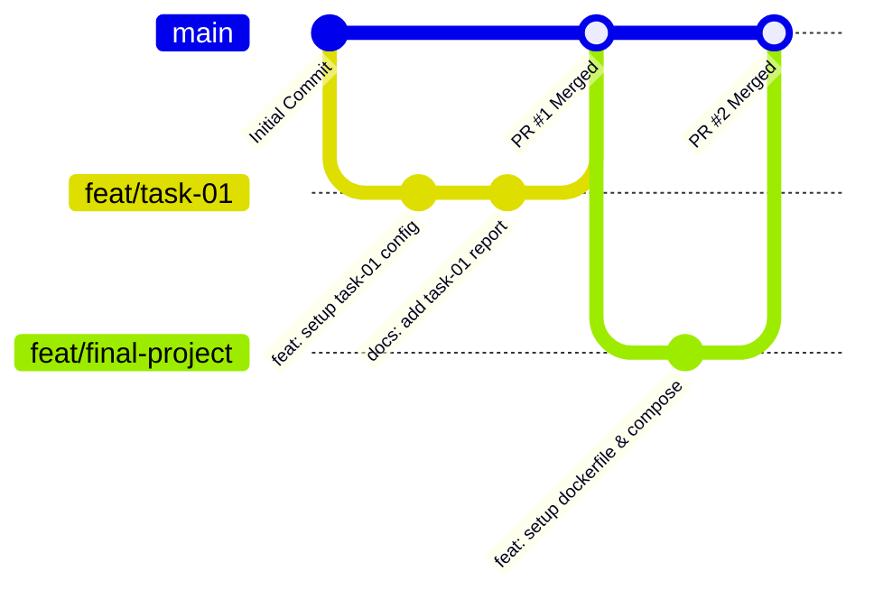

# 🚀 Software Deployment and Implementation
<div align="center">

### Repository Praktikum & Proyek Akhir Kolaborasi Kelompok

[](#-informasi-akademik)
[-412991?style=for-the-badge&logo=buffer&logoColor=white)](#-informasi-akademik)
[](#-informasi-akademik)
[](#-daftar-tugas--progress-tracker)

<p align="center">
  <b>Repository resmi kelompok untuk dokumentasi tugas perkuliahan, modul praktikum, dan implementasi proyek akhir mata kuliah Software Deployment and Implementation.</b>
</p>

[📚 Info Kuliah](#-informasi-akademik) •
[👥 Anggota Tim](#-tim-pengembang) •
[🎯 Tujuan](#-tujuan--cakupan-repository) •
[📂 Struktur Direktori](#-struktur-repository) •
[📊 Progress Tracker](#-daftar-tugas--progress-tracker) •
[🛠️ Tech Stack](#️-tech-stack--ecosystem) •
[🌿 Git Workflow](#-standar-dan-alur-kerja-kolaborasi)

---

</div>

## 📌 Informasi Akademik

| Komponen | Keterangan |
| :--- | :--- |
| **Mata Kuliah** | Software Deployment and Implementation |
| **Program Studi** | S1 Teknik Informatika (Bachelor of Informatics Engineering) |
| **Semester** | 7 (Tujuh) |
| **Dosen Pengampu** | *Agus Barlianto* |
| **Institusi** | *Perbanas Institute* |
| **Fungsi Repository** | Dokumentasi proses belajar, pengumpulan tugas, dan evaluasi berkala bersama dosen. |

---

## 👥 Tim Pengembang

<div align="center">

| Avatar | Nama Lengkap | NIM | Peran Utama | Profil / Kontak |
| :---: | :--- | :---: | :--- | :---: |
|  | **Nur Akhmad Van Jouvi** | `2314000024` | Team Member / DevOps & Implementation | [](https://github.com/) |
|  | **Adelia Rahma Zalianty** | `2314000029` | Team Member / System & Documentation | [](https://github.com/) |

</div>

---

## 🎯 Tujuan & Cakupan Repository

Repository ini didedikasikan untuk memenuhi standar perkuliahan dan kolaborasi berbasis industri, yang mencakup:

* **Penyimpanan Source Code Terpusat**: Seluruh tugas mandiri maupun kelompok tersusun modular dan terdokumentasi rapi.
* **Implementasi CI/CD & Deployment Modern**: Menerapkan konsep otomatisasi build, containerization, dan deployment ke server/cloud environment.
* **Dokumentasi Teknis yang Komprehensif**: Menyediakan catatan arsitektur, konfigurasi server, serta panduan pengujian di setiap modul.
* **Kolaborasi Standar Industri**: Menerapkan *Git Flow*, *Pull Request Review*, dan *Conventional Commits* antar anggota tim.
* **Final Project Showcase**: Wadah utama implementasi sistem terintegrasi yang siap dipresentasikan dan diuji oleh dosen pengampu.

---

## 📂 Struktur Repository

```bash
software-deployment-and-implementation/
│
├── 📁 assignment/                 # Kumpulan tugas & praktikum mingguan
│   ├── 📁 task-01/                # Modul 1: [Topik Praktikum 1]
│   ├── 📁 task-02/                # Modul 2: [Topik Praktikum 2]
│   └── 📁 task-03/                # Modul 3: [Topik Praktikum 3]
│
├── 📁 final-project/              # Kode sumber & konfigurasi Proyek Akhir
│   ├── 📁 src/                    # Source code aplikasi utama
│   ├── 📁 deployment/             # Skrip deploy (Docker, CI/CD, Nginx config)
│   └── 📄 README.md               # Dokumentasi teknis khusus Final Project
│
├── 📁 documentation/              # Laporan, diagram arsitektur, & materi presentasi
│   ├── 📁 architecture/           # Diagram alur sistem & infrastruktur
│   └── 📁 reports/                # Laporan praktikum & dokumentasi teknis
│
└── 📄 README.md                   # Dokumentasi utama repository
```

---

## 📊 Daftar Tugas & Progress Tracker

Tabel pelacak status pengerjaan untuk mempermudah monitoring dan evaluasi oleh dosen pengampu:

| No | Modul / Tugas | Deskripsi Singkat | Status | Direktori / Tautan | Evaluasi & Feedback |
| :---: | :--- | :--- | :---: | :---: | :---: |
| 01 | **Task 01** | Setup Environment & Basic Deployment Configuration | `📝 Direncanakan` | [`assignment/task-01`](./assignment/task-01) | - |
| 02 | **Task 02** | Containerization with Docker & Multi-stage Builds | `📝 Direncanakan` | [`assignment/task-02`](./assignment/task-02) | - |
| 03 | **Task 03** | CI/CD Pipeline Automation & Testing Integration | `📝 Direncanakan` | [`assignment/task-03`](./assignment/task-03) | - |
| 04 | **Final Project** | End-to-End System Deployment & Monitoring | `🚀 In Progress` | [`final-project`](./final-project) | - |

> *Keterangan Status: `📝 Direncanakan` \| `🚧 Dalam Pengerjaan` \| `🔍 Siap Direview` \| `✅ Selesai`*

---

## 🛠️ Tech Stack & Ecosystem

Teknologi, tools, dan platform yang digunakan dalam mata kuliah ini:

| Kategori | Teknologi & Tools |
| :--- | :--- |
| **Version Control & CI/CD** |    |
| **Container & Virtualization** |   |
| **Web Server & Reverse Proxy**|  |
| **Operating System & Cloud**   |   |
| **Documentation & Formats**   |   |

---

## 🌿 Standar dan Alur Kerja Kolaborasi

Untuk menjaga kualitas kode, konsistensi riwayat komit, dan kemudahan kolaborasi, tim menerapkan standar berikut:

### 1. Konvensi Penamaan Branch
* `main` : Branch produksi/stabil utama yang siap ditinjau dosen pengampu.
* `feat/<nama-fitur>` : Pengerjaan modul atau penambahan fitur baru (contoh: `feat/task-01-docker`).
* `fix/<nama-bug>` : Perbaikan konfigurasi, script, atau bug.
* `docs/<topik>` : Penambahan dokumentasi, laporan, atau revisi README.

### 2. Standar Pesan Commit (Conventional Commits)
Format penulisan commit: `<type>: <deskripsi singkat>`
* `feat:` Menambahkan fitur baru, modul tugas, atau konfigurasi deployment.
* `fix:` Memperbaiki bug atau kesalahan konfigurasi.
* `docs:` Memperbarui dokumentasi, laporan, atau panduan setup.
* `refactor:` Mengubah struktur kode/skrip tanpa mengubah fungsionalitas.
* `chore:` Penyesuaian tooling, dependencies, atau file `.gitignore`.

### 3. Diagram Alur Kolaborasi


---

## 🚀 Panduan Memulai (Getting Started)

### 1. Melakukan Clone Repository
```bash
git clone https://github.com/[username]/[repo-name].git
cd software-deployment-and-implementation
```

### 2. Membuat Branch Pengerjaan Baru
```bash
git checkout -b feat/nama-tugas-atau-fitur
```

### 3. Menyimpan & Mengirim Perubahan
```bash
git add .
git commit -m "feat: menambahkan konfigurasi deployment modul X"
git push origin feat/nama-tugas-atau-fitur
```
*Buka **Pull Request (PR)** di GitHub menuju branch `main` untuk direview bersama rekan tim sebelum di-merge.*

---

<div align="center">
  <sub>Software Deployment and Implementation • S1 Teknik Informatika • Semester 7</sub><br>
  <sub>Dikembangkan dan dikelola dengan penuh dedikasi oleh Tim Mahasiswa.</sub>
</div>

